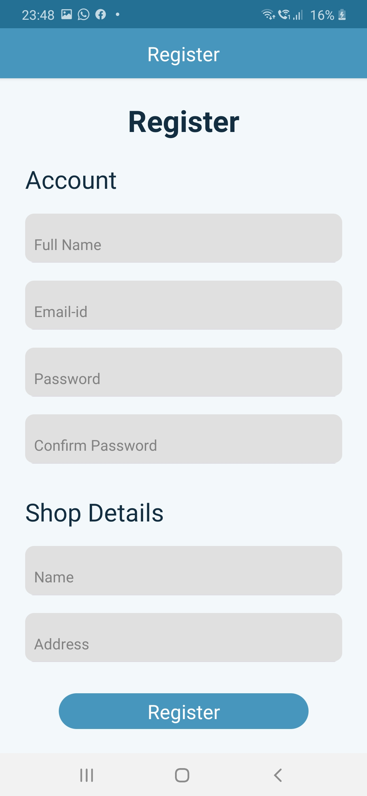
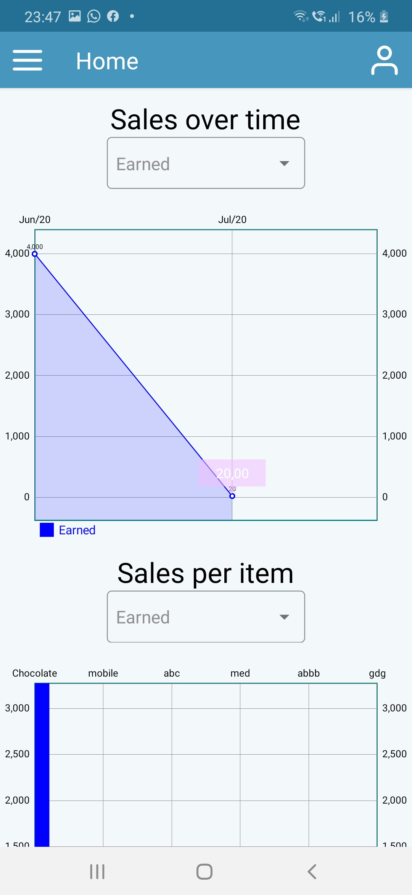
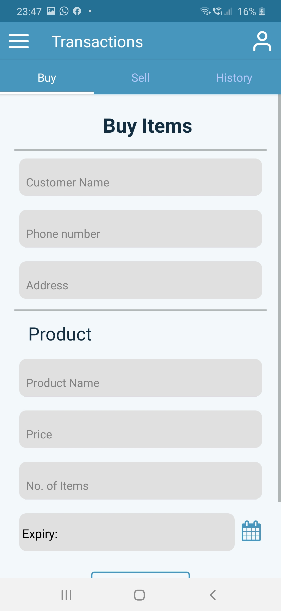
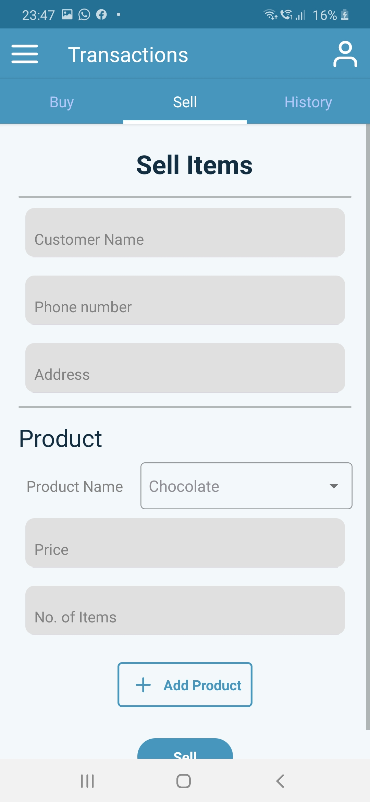

<h1 align="center">Shop Inventory Management App</h1>

  A cross-platform React Native mobile application designed for small shop owners to seamlessly manage inventory, track purchases and sales, monitor expiry dates, and oversee employee operations.

  Maintained by <a href="https://github.com/Meetbahl04">Meet Bahl</a>
  &nbsp;|&nbsp; <a href="#features">Features</a>
  &nbsp;|&nbsp; <a href="#tech-stack">Tech Stack</a>
  &nbsp;|&nbsp; <a href="#getting-started">Setup</a>

---

## About

This mobile application provides a comprehensive digital ledger for small businesses, helping shop owners keep complete track of stock, financial transactions, and workforce details in one centralized interface. Users can authenticate securely, view sales analytics and profit charts on an interactive dashboard, browse and update inventory items, log daily purchases and sales, review transaction histories, and manage employee access based on role permissions.

The app serves as the **mobile frontend client**, communicating with a securely hosted backend REST API to handle data persistence, authentication, and business logic.

## Features

- **Secure Authentication:** User login and registration powered by email/password authentication, with session state securely cached on-device using AsyncStorage.
- **Interactive Dashboard:** Dynamic charts illustrating sales trends over time and item-wise sales (with toggleable earnings and expenditure views, supporting zoom controls).
- **Inventory Management:** Real-time catalog overview showing product quantities, buying/selling prices, expiry tracking, and critical low-stock thresholds.
- **Near-Expiry Tracking:** Dedicated monitoring for perishable stock expiring within the next 3 days to help mitigate business losses.
- **Purchase & Sales Recording:** Streamlined forms for logging new inventory acquisitions (with optional expiry dates for perishables) and customer checkouts, automatically updating records via the API.
- **Transaction Ledger:** Detailed transaction history logs capturing product details, quantities, pricing, and transaction type.
- **Role-Based Employee Management:** Comprehensive workforce management allowing authorized administrators (owners and managers) to view, add, edit, and remove employees.

## Tech Stack

| Area | Tools & Technologies |
|---|---|
| Framework | React Native, JavaScript |
| Navigation | React Navigation (Stack and Drawer Navigators) |
| Data Storage | AsyncStorage |
| Networking | RESTful HTTP integration |
| Tooling & Quality | ESLint, Prettier, Metro Bundler, Gradle, CocoaPods |

## Screenshots

| | | |
|:---:|:---:|:---:|
|  |  |  |
| Splash | Login | Register |
|  |  |  |
| Dashboard | Side drawer | Profile |
|  |  |  |
| Inventory | Near expiry | Buy |
|  |  |  |
| Sell | Transaction history | Employees |
|  | | |
| Add employee | | |

## Project Structure
